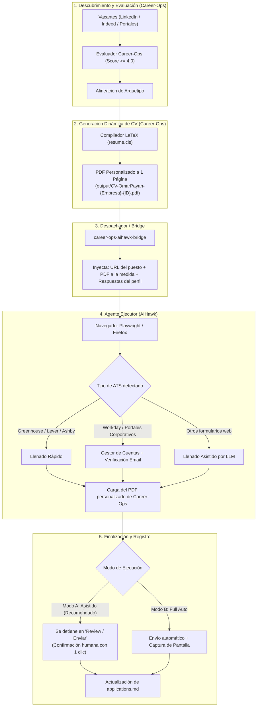

# Arquitectura Híbrida: Career-Ops + Jobs_Applier_AI_Agent (AIHawk)

## 1. Visión General y Genealogía Compartida

Existe un vínculo directo entre ambos proyectos:
En el código fuente de **Jobs_Applier_AI_Agent (AIHawk)**, el archivo `src/aihawk/documents.py` declara explícitamente:
> *"Judging a job against the CV. The rubric's shape is adapted from career-ops (MIT)."*
> *(Y en su archivo NOTICE se acredita formalmente a Santiago Fernandez de Valderrama y career-ops).*

Esto significa que ambos sistemas comparten la misma filosofía de evaluación dimensional de vacantes. La oportunidad de integrarlos en una **arquitectura híbrida** aprovecha lo mejor de cada uno:

- **Career-Ops (El Cerebro Estratégico):**
  - Motor de búsqueda y filtrado de alta precisión.
  - Generador dinámico de CVs personalizados a 1 página en LaTeX (adaptando experiencia, habilidades y proyectos con socios formadores como Intel y OMRON para cada vacante individual).
  - Base de conocimientos de respuestas seguras para screening (evitando trampas ATS).
- **Jobs_Applier_AI_Agent (Las Manos Ejecutoras):**
  - Agente de navegación en navegador real mediante `invisible-playwright-mcp` (con evasión de detección de bots).
  - Plugins especializados para rellenar formularios en los ATS más comunes: Workday, Greenhouse, Lever, Ashby, SmartRecruiters, BambooHR, Personio, Breezy, Recruitee, TeamTailor.
  - Gestión automática de cuentas (creación y guardado de credenciales para Workday) y lectura de códigos de verificación por correo electrónico.

---

## 2. Diagrama de la Arquitectura Híbrida

---

## 3. Componentes del Puente (The Bridge)

### A. Ubicación del Agente
- Repositorio clonado en: `/home/opyntorr/Jobs_Applier_AI_Agent`
- Acceso directo integrado: `/home/opyntorr/career-ops/integrations/aihawk`

### B. Inyección Dinámica del CV
En lugar de que AIHawk utilice un único currículum estático para todas las aplicaciones, el script puente:
1. Toma la vacante calificada en `applications.md` o la cola de procesamiento.
2. Identifica la ruta del PDF generado específicamente para esa postulación (`output/CV-OmarPayan-<slug>-<id>.pdf`).
3. Sobrescribe dinámicamente la configuración temporal del agente para que el archivo adjuntado en el formulario sea el PDF hiper-personalizado.

### C. Modos de Operación

1. **Modo A: Asistido / Human-in-the-Loop (`AIHAWK_DRY_RUN=1`):**
   - El bot navega, crea la cuenta si es necesario, rellena todos los campos con los datos de tu perfil y adjunta el PDF personalizado.
   - Se detiene exactamente en la pantalla final de **Revisar / Submit**.
   - Tú solo revisas que no haya respuestas extrañas y das el clic final.
   - **Ventaja:** Cero riesgo de alucinación en preguntas de visa/salario y cero riesgo de baneo.

2. **Modo B: Full Auto (Para portales rápidos como Greenhouse / Lever / Ashby):**
   - El agente ejecuta la postulación de principio a fin de forma autónoma.
   - Guarda una captura de pantalla del comprobante de envío en `career-ops/output/proofs/`.
   - Marca automáticamente la vacante como `Applied` en [applications.md](file:///home/opyntorr/career-ops/data/applications.md).

3. **Modo C: Fallback Manual (Extensión Career-Ops FastApply):**
   - Para portales con CAPTCHAs complejos o que requieren interacción física obligatoria.
